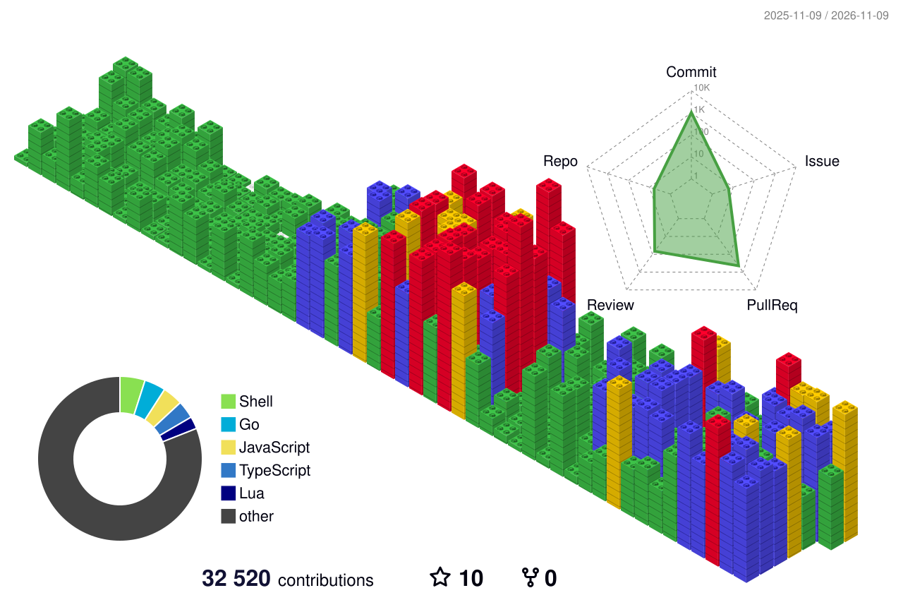

# Ioannis Karasavvaidis

Principal-level engineer in Belfast, building software professionally since 2000: backend, frontend, data, cloud and security. These days I'm a software engineer at **Upwind Security**, working on CloudScanner.

[greekdev.io](https://www.greekdev.io) · [LinkedIn](https://linkedin.com/in/johnkarasavvaidis) · the@greekdev.io

## Now

- **Upwind Security**: small skunkworks team on CloudScanner, Upwind's agentless scanner for workloads on AWS, Azure, GCP and OCI.
- **Studio110**: my product engineering studio. With [Upmate](https://github.com/Upmate) we build and run e-commerce platforms, and I build products of my own.

## Before

**Puppet / Perforce, 2017–2026.** Principal engineer and tech lead. Founding engineer on Puppet Comply and Puppet CloudOps, a multi-cloud FinOps platform where p95 queries went from ~20s to sub-second. Created the [Puppet Installation Manager](https://www.puppet.com/downloads/puppet-installation-manager), a guided Go TUI for installing Puppet Enterprise. Grew the team from 5 to 18.

## Products

- **[Pullminder](https://pullminder.com)**: risk scores, policy gates and a reviewer brief for every pull request. GitHub App, [CLI](https://github.com/pullminder/cli), CI Action and a public [rule registry](https://github.com/pullminder/registry).
- **[TTYper](https://ttyper.com)**: typing practice and races over SSH. Try `ssh ttyper.com`.

## Open source

- [second-brain-mcp](https://github.com/CoMfUcIoS/second-brain-mcp): MCP server that gives LLMs read-only access to an Obsidian vault. 
- [kite](https://github.com/CoMfUcIoS/kite): one terminal view of every git repo in a directory: branches, dirty state, PRs, CI. 
- [vw](https://github.com/CoMfUcIoS/vw): friendlier CLI for Bitwarden and Vaultwarden, on top of the official `bw`.
- [codex-mcp-server](https://github.com/CoMfUcIoS/codex-mcp-server): extended fork of [tuannvm/codex-mcp-server](https://github.com/tuannvm/codex-mcp-server) with streaming, paging and sessions, published as `@comfucios/codex-mcp-server`.
- [GraphQLens](https://github.com/CoMfUcIoS/GraphQLens): Chrome DevTools extension for inspecting and mocking GraphQL traffic.
- [console-inline.nvim](https://github.com/CoMfUcIoS/console-inline.nvim): Neovim plugin that shows console output inline, next to the code that logged it.
- [socket.io-pouch](https://github.com/CoMfUcIoS/socket.io-pouch): PouchDB and CouchDB replication over Socket.io. 

## Writing

Latest from the [Strong Password Meter blog](https://www.strongpasswordmeter.com/en/blog):

- [Railway&#39;s stolen API keys: rotate secrets without breaking your app](https://www.strongpasswordmeter.com/en/blog/railway-api-keys-secret-rotation) `today`
- [Chainalysis breach: reset passwords and API keys in the right order](https://www.strongpasswordmeter.com/en/blog/chainalysis-credential-exposure-response) `3 days ago`
- [mSecure&#39;s cloud vault warning: which passwords should you change first?](https://www.strongpasswordmeter.com/en/blog/msecure-cloud-vault-warning) `6 days ago`
- [Microsoft Authenticator&#39;s Android token flaw: update first, don&#39;t panic](https://www.strongpasswordmeter.com/en/blog/microsoft-authenticator-android-token-flaw) `1 week ago`
- [Lost Your Phone? Make an Account Recovery Plan Before You Need One](https://www.strongpasswordmeter.com/en/blog/backup-codes-account-recovery-plan) `1 week ago`

## Stack

- **Languages:** Go · TypeScript · JavaScript · Python · Ruby · PHP · SQL · Bash
- **Frontend:** React · TanStack Start / Router / Query · Astro · Vite · Tailwind CSS · Apollo Client
- **Backend:** Go microservices · Node.js · GraphQL (Apollo Federation, gqlgen) · REST · gRPC · WebSockets · Bubble Tea TUIs
- **Data:** PostgreSQL · ClickHouse · MySQL / Galera · Redis · Kafka · AWS SQS · Meilisearch · Solr
- **Cloud & infra:** AWS · GCP · Azure · OCI · Cloudflare Workers · Kubernetes · KEDA · Helm · Docker · Terraform · Puppet · Bolt · GitHub Actions
- **Observability:** Prometheus · Grafana · OpenTelemetry · ELK / OpenSearch
- **AI engineering:** Claude Code · MCP servers · agentic SDLC

## GitHub activity

 

